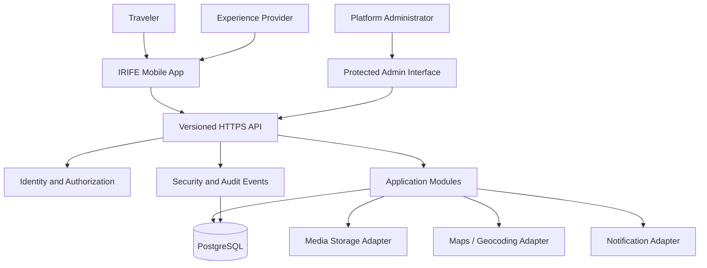
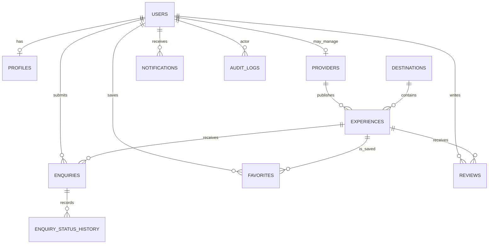
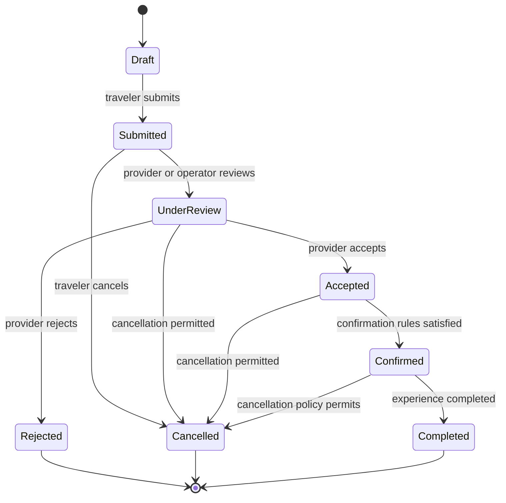

# IRIFE — System Architecture

**Document ID:** IRIFE-ARCH-001  
**Version:** 1.0  
**Status:** Engineering baseline  
**Repository:** `elmaloufi/irife-brand-assets`  
**Working branch:** `feat/irife-mobile-platform-foundation`  
**Last updated:** 2026-11-19

> This document is the baseline architecture for IRIFE. It turns the approved product direction into an implementable engineering plan. It does not imply that the application, backend, database, or integrations already exist.

## 1. Product and system goals

IRIFE is a mobile-first travel platform focused on Morocco. It helps travelers discover destinations and experiences, connect with providers, and submit and track booking enquiries.

### Primary user groups

- **Traveler:** discovers destinations and experiences, saves favorites, and submits or tracks requests.
- **Experience provider:** manages a provider profile and responds to relevant enquiries. Provider onboarding and verification rules must be defined before public launch.
- **Administrator / moderator:** manages platform content, provider status, reports, and operational review through role-protected tools.

### Phase-one product outcome

Deliver one secure end-to-end vertical slice:

1. Browse published destinations and experiences.
2. Open a destination or experience detail page.
3. Submit an enquiry / booking request.
4. View only the authenticated user's own requests and their current status.

Payments, payouts, real-time availability guarantees, and complex provider marketplace operations are outside the foundation release.

## 2. Approved decisions and open decisions

### Approved

| Area | Decision |
|---|---|
| Mobile platform | Expo + React Native |
| Language | TypeScript |
| Navigation | Expo Router |
| Database | PostgreSQL |
| Local database runtime | Docker |
| Repository | Existing repository: `elmaloufi/irife-brand-assets` |
| Payments | Later phase; do not implement in foundation |
| Production deployment | Not allowed without separate explicit approval |
| Git workflow | Feature branches and pull requests; no direct commits to `main` |

### Proposed, not yet approved as implementation choices

| Area | Current proposal / open decision |
|---|---|
| Backend architecture | Start with a modular monolith; reassess only when measured scale or team boundaries justify it |
| Backend framework | Open; select after a short technical evaluation |
| API style | Versioned REST/JSON is the initial proposal |
| Maps provider | Open |
| Media/object storage | Open |
| Push notification provider | Open |
| Admin interface | Open; keep admin operations behind server-enforced roles |
| Hosting / production topology | Open; no production deployment in this phase |

Do not treat a proposed item as an approved dependency until its decision record is accepted.

## 3. High-level system context



**Trust boundaries:** the mobile app and any future admin web client are untrusted clients. Authentication, authorization, validation, ownership checks, pricing or availability rules, and state transitions must be enforced by the server. A hidden button or client-side check is not an authorization control.

## 4. Logical architecture

### 4.1 Mobile application

Target location: `apps/mobile/`

- **Presentation:** screens, layouts, reusable UI components, accessibility, localization.
- **Navigation:** Expo Router routes and protected route groups.
- **Feature modules:** discovery, destinations, experiences, enquiries, favorites, profile, notifications.
- **Application services:** typed API client, session coordination, query/cache policy, and error mapping.
- **Shared contracts:** request/response types imported from the shared contracts package when that package is introduced.
- **Device adapters:** secure token storage, location permission handling, image selection, and push token registration.

Mobile responsibilities are limited to presentation and user interaction. It must not contain database credentials, provider secrets, privileged admin credentials, or authoritative booking rules.

### 4.2 Backend

Target location: `services/api/`

Recommended initial deployment unit: a **modular monolith** with clear internal module boundaries. This keeps operational complexity low while allowing modules to be extracted later if evidence supports it.

| Module | Responsibilities |
|---|---|
| Identity | Registration/login strategy, sessions, token lifecycle |
| Authorization | Roles, permissions, ownership and policy checks |
| Profiles | Traveler and provider profile data |
| Destinations | Cities, places, destination publishing |
| Experiences | Experience content, categories, media references |
| Providers | Provider profiles, onboarding and review status |
| Discovery | Filtering, sorting and search orchestration |
| Enquiries | Request creation, ownership, provider response, lifecycle |
| Reviews | Review eligibility, moderation and publication |
| Notifications | User preferences and delivery orchestration |
| Administration | Moderation actions and protected operational workflows |
| Audit | Security-sensitive and administrative event records |

Modules must communicate through explicit application interfaces. Avoid circular imports and unrestricted direct access to another module's persistence layer.

### 4.3 Data layer

PostgreSQL is the source of truth for transactional platform data. Local development uses Docker Compose and repeatable migrations.

Initial logical entities:

- `users`
- `profiles`
- `roles` / `user_roles` (or an equivalent explicit authorization model)
- `providers`
- `destinations`
- `experiences`
- `experience_media`
- `enquiries`
- `enquiry_status_history`
- `favorites`
- `reviews`
- `notifications`
- `notification_preferences`
- `audit_logs`

Use stable primary keys, foreign keys, unique constraints, indexes for real query patterns, timestamps, and explicit deletion/retention policies. Store external media references rather than large image binaries in ordinary relational rows.

### 4.4 Logical data relationships



This is a logical starting model, not a finalized migration schema. Detailed columns, constraints, provider multi-user access, and review eligibility must be specified before migrations are written.

## 5. Core enquiry / booking-request lifecycle

The foundation release manages requests; it does not process payments or promise live inventory.



Rules:

- Every transition is validated on the server against the current state and actor's permissions.
- Every transition records actor, timestamp, previous state, new state, and a safe reason/reference.
- Duplicate submissions must be handled idempotently where appropriate.
- Users can read only their own requests; providers can access only requests routed to their provider account.
- Do not show “confirmed” until the server has committed the corresponding transition.
- Availability text must be clearly described as provider-supplied or request-based unless a reliable live inventory integration exists.

## 6. API boundary and initial contract outline

The initial proposal is REST/JSON under `/api/v1`. Exact schemas and error codes belong in versioned API contract files before backend implementation.

| Method | Proposed endpoint | Purpose |
|---|---|---|
| GET | `/api/v1/destinations` | List published destinations |
| GET | `/api/v1/destinations/{id}` | Destination details |
| GET | `/api/v1/experiences` | Search/list published experiences |
| GET | `/api/v1/experiences/{id}` | Experience details |
| POST | `/api/v1/enquiries` | Submit an enquiry |
| GET | `/api/v1/me/enquiries` | List the current user's requests |
| GET | `/api/v1/me/enquiries/{id}` | View one owned request |
| POST | `/api/v1/me/enquiries/{id}/cancel` | Request cancellation where permitted |

Contract requirements:

- Validate request bodies, path parameters, query parameters, and response shapes.
- Use consistent pagination, filtering, error envelopes, and request identifiers.
- Derive user identity from the validated server session/token, never from a client-supplied user ID.
- Apply authorization and resource ownership checks on every protected operation.
- Avoid leaking internal exception details, stack traces, or sensitive provider/user data.

## 7. Security and privacy baseline

### Identity and access control

- Use a reviewed authentication approach and secure session/token lifecycle.
- Enforce role and resource-level authorization server-side.
- Deny by default; grant only the minimum permissions required.
- Add rate limits to login, enquiry submission, and other abuse-prone operations.

### Data protection

- Collect only information required for the requested user journey.
- Keep secrets in environment/secret storage; commit only safe example placeholders.
- Use TLS for network traffic in deployed environments.
- Restrict database access and use least-privilege database credentials.
- Define retention, export, deletion, and support-access rules before collecting sensitive profile data.
- Avoid putting secrets, full personal data, or authentication tokens in application logs.

### Threats to test

| Threat | Required control |
|---|---|
| IDOR / cross-user request access | Server-side ownership checks and negative tests |
| Privilege escalation | Central authorization policy and role tests |
| Spam / automated enquiry abuse | Rate limiting, validation, abuse monitoring |
| Token theft or replay | Secure storage, rotation/revocation strategy |
| Malicious uploads | File type/size validation, safe storage and delivery |
| Injection | Parameterized database access and input validation |
| Sensitive data leakage | Log redaction, response minimization, access review |
| Invalid lifecycle transitions | Server-side state machine and concurrency-safe updates |

A formal threat model should be reviewed before the first authenticated end-to-end release.

## 8. Quality attributes and engineering gates

- **Reliability:** bounded retries, explicit error states, idempotent request handling where needed.
- **Performance:** paginated discovery endpoints, indexes based on measured query patterns, image optimization.
- **Accessibility:** labeled controls, adequate contrast, screen-reader support, scalable text.
- **Localization:** prepare for Arabic, French, and English without hard-coding UI strings.
- **Observability:** structured logs, request IDs, privacy-aware error monitoring; do not add analytics that collect personal data without a defined purpose and consent strategy.
- **Testing:** unit tests for domain rules, API integration tests, database migration tests, authorization negative tests, and mobile critical-path tests.
- **CI:** install, lint, type-check, test, and build steps must reflect the actual project structure and lockfile.

A pull request is merge-ready only when acceptance criteria, test evidence, security implications, and documentation are reviewed and required CI checks pass.

## 9. Repository layout target

The following is the intended target layout. It is not a claim that these directories already exist.

```text
irife-brand-assets/
├── apps/
│   └── mobile/
│       ├── app/
│       ├── components/
│       ├── features/
│       ├── hooks/
│       ├── services/
│       ├── constants/
│       └── assets/
├── services/
│   └── api/
├── packages/
│   ├── contracts/
│   ├── shared/
│   └── config/
├── database/
│   ├── migrations/
│   └── seeds/
├── docs/
│   ├── engineering/
│   ├── architecture/
│   ├── product/
│   └── security/
├── docker-compose.yml
└── README.md
```

Keep existing brand assets and licensing/attribution information intact. Do not move or delete design files as part of the application scaffold without a separate review.

## 10. Delivery roadmap

| Step | Deliverable | Exit criteria |
|---|---|---|
| 0. Repository audit | Inventory, workflow review, asset preservation plan | Existing workflows and deployment triggers understood |
| 1. Product definition | PRD and acceptance criteria | Phase-one scope and personas reviewed |
| 2. Architecture & security | This architecture, ADRs, threat model | Open decisions recorded; security risks reviewed |
| 3. Mobile foundation | Expo app, TypeScript, Expo Router | Clean install, lint, type-check and app startup |
| 4. Contracts | Versioned request/response schemas | API contracts reviewed before backend behavior |
| 5. Backend/data foundation | API shell, PostgreSQL, Docker Compose, migrations | Repeatable local startup and migration tests |
| 6. Vertical slice | Discovery → details → enquiry → own request list | Critical paths and authorization tests pass |
| 7. Hardening | Accessibility, observability, security and CI | Required checks pass; PR review completed |

No production deployment, payment activation, or merge to `main` is authorized by this roadmap.

## 11. Repository audit observations (2026-11-19)

The following paths were checked on `feat/irife-mobile-platform-foundation`:

- `README.md` describes the repository as official IRIFE brand assets, SVG logos, visual identity, design resources, and digital branding components.
- `docs/engineering/FOUNDATION.md` exists and records the approved Expo/PostgreSQL/Docker/payment/deployment decisions.
- `package.json`, `apps/mobile/package.json`, `app.json`, `docker-compose.yml`, `pnpm-workspace.yaml`, and the proposed architecture document did not exist at the time of this audit.
- `.github/workflows/blank.yml` has been updated on this branch to install the npm workspace and run the mobile TypeScript build. It currently uses `npm install` because no lockfile could be generated in the current remote editing environment; commit a verified `package-lock.json` and switch CI to `npm ci` before treating dependency installation as fully reproducible.
- The original `.github/workflows/nextjs.yml` contained an automatic GitHub Pages deployment on pushes to `main`. On this feature branch it has been replaced with a manually-triggered no-op deployment gate, preventing automatic Pages deployment when this branch is eventually merged. No deployment was run.
- CodeQL is configured for GitHub Actions analysis. Its language coverage should be revisited when TypeScript application code is introduced.

This is a targeted path audit, not a complete recursive inventory of every repository file.

## 12. Immediate next engineering tasks

1. Complete a full repository and workflow inventory; preserve all existing brand assets.
2. Review and approve the phase-one PRD, including user stories and acceptance criteria.
3. Create ADRs for backend framework, API conventions, authentication/session strategy, and provider authorization.
4. Create the formal threat model and data classification/retention rules.
5. Scaffold the Expo application on this feature branch only.
6. Replace or split the placeholder CI workflow so it validates the actual mobile workspace; keep deployment workflows separate from validation workflows.

---

**Change control:** all implementation changes must be made on feature branches and reviewed through pull requests. Do not commit directly to `main`. Do not merge, publish, deploy, enable payments, or introduce paid services without explicit approval.
